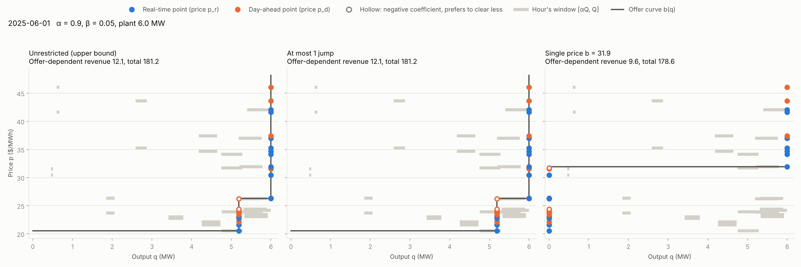
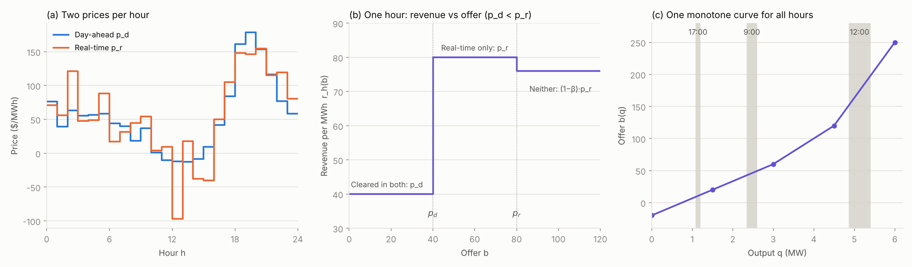
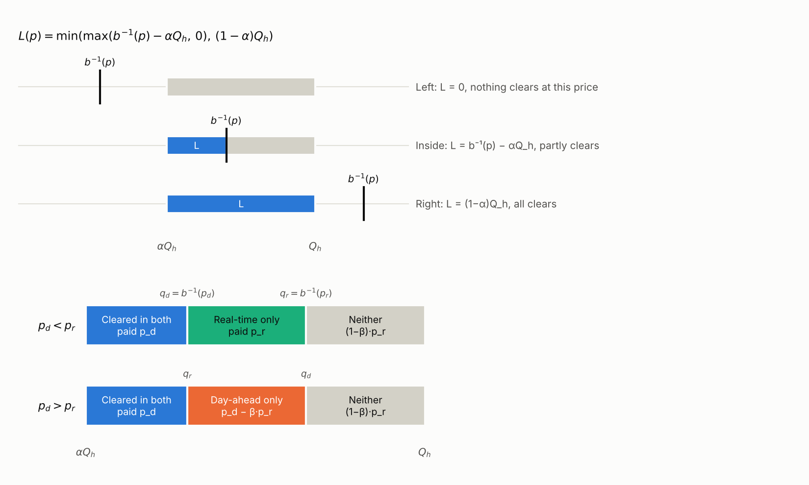
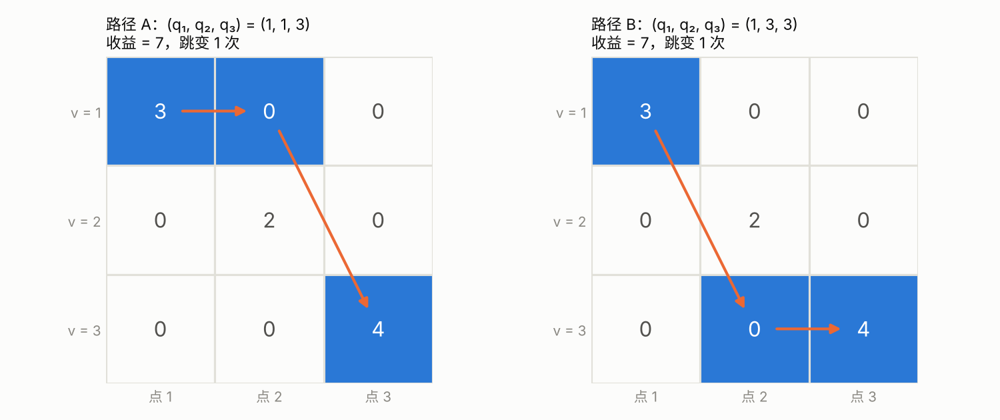

# Exact offer-curve bidding for a solar plant

**Problem.** A solar plant submits **one** non-decreasing price–quantity offer curve per day, and that same curve is settled against both a day-ahead and a real-time price in each of the 24 hours. Revenue is a step function of the offer, so the problem is usually attacked by scanning a single flat price or by heuristic search (genetic algorithms, particle swarm). Neither says how far its answer is from the best curve.

**Method.** The curve affects revenue only through its inverse at the 48 hourly prices. The objective then splits into 48 one-variable terms, and the monotonicity requirement becomes a chain $q_1 \le q_2 \le \cdots \le q_{48}$. A dynamic programme solves this exactly; a counter on the number of jumps limits how many steps the curve may have.

**Results.** With prices known, the solver returns the best curve in hindsight, an upper bound for any bidding strategy.

- **Exact, and checked.** It matches brute-force enumeration on 200 random cases, and on all seven days of CAISO data it matches exhaustive enumeration (up to $5.8 \times 10^8$ curves per day) and an integer-programming solver.
- **What curve shape is worth.** Over one week of CAISO data the best curve earns 0.55% more than the best single price on the offer-dependent output (0–1.4% per day), about 0.06% of the plant's total revenue. Allowing one jump captures 73% of that gap, and the optimum never needs more than two.

[The problem](#the-problem) · [Results](#results) · [Derivation](#derivation) · [Code](#code)

## The problem

**Setting.** For each delivery hour $h = 1, \dots, 24$ there are two prices for the same hour:

- the day-ahead price $p_{d,h}$, set the day before delivery;
- the real-time price $p_{r,h}$, set on the delivery day.

The plant's forecast output in hour $h$ is $Q_h$ (MW).

**Decision.** The day before delivery, the plant submits one offer curve $b(q)$: the minimum price it accepts for the $q$-th MW of output. The curve must be non-decreasing in $q$, and the **same curve applies to all 24 hours**. Market rules usually allow only a few segments (for example, five points and four segments).

An offer is a threshold, not a price tag: cleared energy is paid the **market price**, not the offer.

**Market rules.**

1. **Priority dispatch.** A share $\alpha$ of forecast output clears unconditionally. Only the window $[\alpha Q_h, Q_h]$ depends on the offer.
2. **Day-ahead.** Energy offered at $b$ clears day-ahead if $b \le p_{d,h}$ and is paid $p_{d,h}$. Energy not sold day-ahead is a deviation and settles at $p_{r,h}$.
3. **Real-time.** Energy clears real-time if $b \le p_{r,h}$. Energy that is produced without clearing real-time is charged a clawback of $\beta p_{r,h}$.
4. **Cleared in both.** The energy settles at $p_{d,h}$ only. It was sold day-ahead, so there is no deviation to settle in real time; the plant neither gets paid twice nor picks the higher price.

For one unit of energy offered at $b$, this gives four outcomes:

| Outcome | Condition | Revenue per MWh |
|---|---|---|
| Cleared in both | $b \le p_d$ and $b \le p_r$ | $p_d$ |
| Day-ahead only | $p_r \lt b \le p_d$ | $p_d - \beta p_r$ |
| Real-time only | $p_d \lt b \le p_r$ | $p_r$ |
| Neither | $b \gt p_d$ and $b \gt p_r$ | $(1-\beta)\,p_r$ |

**Goal.** Choose $b(\cdot)$ to maximise revenue over the day. There are two versions:

- **Prices known** (this repository): the best curve in hindsight. It is an upper bound on what any bidding strategy can achieve, and a benchmark for the next version.
- **Prices random**: maximise expected revenue given a price forecast. This is the real bidding problem.

**Why it is hard.** Taken alone, each hour wants its offer in a particular price range. But one monotone curve must serve every hour, and each hour reads a different part of it: high-output hours read the right end, low-output hours the left end. Midday has the most solar output and often the lowest prices, so the hours pull the curve in opposite directions.

**Parameters.** $\alpha$ and $\beta$ are modelled on publicly documented rules in Chinese provincial spot markets. For example, Guangdong settles 90% of a renewable plant's output outside the offer ($\alpha = 0.9$), and Shandong recovers deviation revenue at 5% of the real-time price ($\beta = 0.05$). The derivation holds for any $\alpha$ and $\beta$; setting both to 0 removes these rules.

## Results

**Data.** One week of CAISO data (1–7 June 2025, SP15 hub), $\alpha = 0.9$, $\beta = 0.05$, a 6 MW plant. Prices are treated as known, so every number below is a hindsight benchmark.

**The solver is exact.** `check_dp.py` compares the dynamic programme with independent methods; its output is in [`results/check_dp.txt`](results/check_dp.txt).

- **200 random small cases.** Every monotone sequence is listed and the best one is compared with the DP, with no jump limit and with at most 0, 1 and 2 jumps. Random cases reach every branch of the DP; real days do not, because their optimal curves use few, large jumps.
- **Each CAISO day.** For at most 0, 1, 2 and 3 jumps, the DP matches exhaustive enumeration of every curve with that many jumps (up to $5.8 \times 10^8$ per day). With no limit there are $10^{15}$ or more curves, too many to list, and the DP matches an integer-programming solver (HiGHS) instead.

All checks pass.

**What curve shape is worth.** Revenue in dollars on the offer-dependent window $[\alpha Q_h, Q_h]$; the share $\alpha$ that clears unconditionally earns the same under every offer and is left out. Produced by `results.py` and saved in [`results/summary.csv`](results/summary.csv).

| Day | Single price | At most 1 jump | Unrestricted | Jumps used | Gain over single price |
|---|---:|---:|---:|---:|---:|
| 2025-06-01 | 178.64 | 181.18 | 181.18 | 1 | 2.54 (1.42%) |
| 2025-06-02 | 111.70 | 111.70 | 111.70 | 1 | 0.00 (0.00%) |
| 2025-06-03 | 134.47 | 134.47 | 134.83 | 2 | 0.37 (0.27%) |
| 2025-06-04 | 80.90 | 80.96 | 81.24 | 2 | 0.34 (0.42%) |
| 2025-06-05 | 129.32 | 129.42 | 129.42 | 1 | 0.10 (0.07%) |
| 2025-06-06 | 129.60 | 130.24 | 130.78 | 2 | 1.18 (0.91%) |
| 2025-06-07 | 59.30 | 59.30 | 59.31 | 2 | 0.01 (0.01%) |
| **Week** | **823.93** | **827.25** | **828.45** | | **4.52 (0.55%)** |

- The best curve beats the best single price on six of the seven days.
- Allowing one jump captures 73% of the week's gap, and the optimum never uses more than two jumps.
- Measured against the plant's total revenue (all output valued at the real-time price), the week's gain is about 0.06%.
- With prices known, a well-chosen flat price is already within about half a percent of the best curve on this week. How close a bid can get when prices must be forecast is the open question (see [Next steps](#next-steps)). This is one summer week at one hub; other seasons and markets may differ.



*2025-06-01, the day with the largest gain. The best curve offers the first 5.2 MW at prices up to 20.5 USD/MWh and the last 0.8 MW at about 26.3 USD/MWh; the best flat offer is 31.9 USD/MWh.*

## Derivation

### Notation

| Symbol | Meaning |
|---|---|
| $h = 1, \dots, 24$ | delivery hour |
| $Q_h$ | forecast output in hour $h$ (MW) |
| $\alpha$ | share of output that clears unconditionally |
| $\beta$ | clawback rate on energy produced without clearing real-time |
| $p_{d,h}$, $p_{r,h}$ | day-ahead and real-time price for the same delivery hour |
| $b(q)$ | offer curve, non-decreasing in $q$, shared by all hours |
| $b^{-1}(p)$ | output that clears at price $p$, i.e. $\sup\lbrace q : b(q) \le p \rbrace$ |

### 1. What the problem looks like



- (a) Each hour has two prices, and which one is higher changes from hour to hour.
- (b) For one unit of energy in one hour, revenue is a three-level step function of the offer, with breakpoints at $p_d$ and $p_r$.
- (c) One monotone curve serves all hours. The time axis maps to the output axis through $Q_h$: each hour only reads the part of the curve inside $[\alpha Q_h, Q_h]$.

### 2. Revenue of one unit: $r_h(b)$

Write the four outcomes as one formula, using "neither" as the baseline and switching on one indicator at a time:

- switching on $\mathbf{1}\lbrace b \le p_r \rbrace$ alone moves revenue from $(1-\beta)p_r$ to $p_r$, a change of $\beta p_r$;
- switching on $\mathbf{1}\lbrace b \le p_d \rbrace$ alone moves it from $(1-\beta)p_r$ to $p_d - \beta p_r$, a change of $p_d - p_r$.

$$
r_h(b) = (1-\beta)\,p_{r,h} + \beta\,p_{r,h}\,\mathbf{1}\lbrace b \le p_{r,h} \rbrace + (p_{d,h} - p_{r,h})\,\mathbf{1}\lbrace b \le p_{d,h} \rbrace
$$

Check "cleared in both": $(1-\beta)p_r + \beta p_r + (p_d - p_r) = p_d$, as in the table.

The two indicators have separate jobs: the day-ahead one decides **which price** the energy settles at, and the real-time one decides **whether the clawback applies**.

Either coefficient can be negative:

- if $p_d \lt p_r$, clearing day-ahead loses money, so the offer should sit between $p_d$ and $p_r$ and the energy should be sold in real time;
- if $p_r \lt 0$, clearing real-time loses money.

### 3. Revenue of one hour: integrate over output

Within an hour, $p_{d,h}$ and $p_{r,h}$ are constants; what varies across the window is the offer $b(q)$. So the integral is over output $q$, not over time:

$$
R_h = \int_{\alpha Q_h}^{Q_h} r_h\big(b(q)\big)\,dq
$$

The constant term integrates to the window length. Each indicator integrates to the length of the part of the window where the condition holds:

$$
\int_{\alpha Q_h}^{Q_h} \mathbf{1}\lbrace b(q) \le p \rbrace\,dq = L_h(p)
$$

Because $b$ is non-decreasing, the set of $q$ in the window with $b(q) \le p$ is a single interval that starts at the left end of the window and ends at $b^{-1}(p)$. Clipping to the window:

$$
L_h(p) = \min\Big(\max\big(b^{-1}(p) - \alpha Q_h,\ 0\big),\ (1-\alpha)Q_h\Big)
$$



The top half shows the three clipping cases. The bottom half shows how the window splits by settlement: into "both, real-time only, neither" when $p_d \lt p_r$, and into "both, day-ahead only, neither" when $p_d \gt p_r$. One formula covers both cases:

$$
R_h = (1-\beta)\,p_{r,h}\,(1-\alpha)Q_h + \beta\,p_{r,h}\,L_h(p_{r,h}) + (p_{d,h} - p_{r,h})\,L_h(p_{d,h})
$$

The units are MWh × USD/MWh = USD. The integral is just bookkeeping: it splits the hour's fixed energy into the parts paid $p_d$, paid $p_r$, and clawed back. The first term does not depend on the offer, so it can be dropped when optimising. The first $\alpha$ share of output is paid a regulated price that also does not depend on the offer, so it is left out entirely.

### 4. One day: 48 points

Summing over hours and dropping constants leaves 48 terms, each with a single unknown:

$$
\text{Revenue} = \text{const} + \sum_{h=1}^{24} \Big[ \underbrace{\beta\,p_{r,h}\,L_h(p_{r,h})}_{\text{real-time point}} + \underbrace{(p_{d,h} - p_{r,h})\,L_h(p_{d,h})}_{\text{day-ahead point}} \Big]
$$

Index the 48 prices as $p_1, \dots, p_{48}$, and record for each point its hour $h(k)$ and whether it is a day-ahead or real-time point. Let

$$
q_k = b^{-1}(p_k), \qquad f_k(q) = c_k \cdot \min\big(\max(q - \alpha Q_{h(k)},\ 0),\ (1-\alpha)Q_{h(k)}\big)
$$

with $c_k = \beta p_{r,h}$ for a real-time point and $c_k = p_{d,h} - p_{r,h}$ for a day-ahead point. Two facts follow.

**The curve only matters at 48 prices.** Two curves with the same $b^{-1}$ at these prices earn the same revenue, however they are drawn in between.

**The constraint is a chain.** Sort the points by price. Since $b$ is non-decreasing,

$$
q_1 \le q_2 \le \cdots \le q_{48}
$$

Points with exactly equal prices must share the same $q$, so they are merged first and their $f$ added.

The two points of one hour can end up far apart after sorting. The chain structure holds only because $R_h$ was split into two terms that each contain a single $q$.

The problem is now

$$
\max_{q_1 \le \cdots \le q_K} \sum_{k=1}^{K} f_k(q_k)
$$

a separable objective under a chain constraint, which is exactly the structure dynamic programming solves.

### 5. Dynamic programming

#### 5.1 Candidate values are window endpoints

Each $f_k$ is piecewise linear with kinks only at its window endpoints $\alpha Q_h$ and $Q_h$. Take an optimal solution and a group of adjacent points sharing a value $v$. Moving $v$ without crossing the neighbouring groups' values changes the group's total revenue as a piecewise linear function of $v$, with kinks at the group's window endpoints. A linear function on an interval is maximised at an end, so $v$ can always be moved to a window endpoint, or onto a neighbouring group's value (merging the groups), without losing revenue. Repeating this puts every $q_k$ in

$$
\mathcal{C} = \lbrace \alpha Q_h,\ Q_h : Q_h \gt 0 \rbrace
$$

which has at most 48 values. Hours with zero output have an empty window and are dropped.

#### 5.2 No restriction on the curve's shape

Let $V_k(v)$ be the best revenue from the first $k$ points with point $k$ at value $v$:

$$
V_k(v) = f_k(v) + \max_{u \le v} V_{k-1}(u)
$$

Looking back one step is enough, for two reasons:

1. **The objective is separable.** No term contains two $q$'s, so the revenue of all earlier points is already summarised in $V_{k-1}$.
2. **The constraint is a chain.** $q_1 \le q_3$ follows from $q_1 \le q_2$ and $q_2 \le q_3$, so point 1 can only affect point 3 through point 2.

The future only needs to know the previous point's value, not how it got there. The result is an upper bound for every monotone offer curve.

#### 5.3 Limiting the number of steps

Markets allow only a few segments, so the curve cannot place every point where it wants. Add a counter $s$: the number of times $q$ has changed up to point $k$.

$$
V_k(v, s) = f_k(v) + \max\Big( V_{k-1}(v, s),\ \max_{u \lt v} V_{k-1}(u, s-1) \Big)
$$

- **Stay:** the previous point has the same $v$, and the counter is unchanged.
- **Jump:** the previous point has a smaller $u$, and the counter increases by one.

The optimum is $\max_{v,\ s \le S} V_K(v, s)$. Since $f_k(v)$ depends only on the end value $v$, it sits outside the max.

**How $S$ relates to segments.** Capping jumps at $S$ finds the best **staircase** curve with $S+1$ steps. Each step is a vertical segment, and consecutive steps are joined by a connecting segment, so such a curve generally needs $2S+3$ segments. The lowest step can sit at $q=0$ if it takes the smallest candidate value, and the highest can sit at full capacity if it takes the largest; each saves one segment. A five-point, four-segment staircase therefore allows at most $S=1$, and only if at least one step touches an end. Curves with sloped segments are outside this DP and left for future work.

A single flat offer is a special case of $S=1$: points below the jump take the smallest value and points above take the largest, and only the jump position is chosen. So

$$
\text{single price} \le \text{at most one jump} \le \text{unrestricted}
$$

#### 5.4 Worked example

Three points, already sorted by price, candidate values $v \in \lbrace 1, 2, 3 \rbrace$, at most one jump ($S = 1$):

| $v$ | $f_1$ | $f_2$ | $f_3$ |
|---|---|---|---|
| 1 | **3** | 0 | 0 |
| 2 | 0 | **2** | 0 |
| 3 | 0 | 0 | **4** |

Each point wants a different value. Without a cap the optimum is $(1, 2, 3)$ with revenue 9, but that takes two jumps.

**Point 1:** no jump is possible yet.

| $v$ | $s=0$ | $s=1$ |
|---|---|---|
| 1 | 3 | $-\infty$ |
| 2 | 0 | $-\infty$ |
| 3 | 0 | $-\infty$ |

**Point 2:** for example, $V_2(2,1) = f_2(2) + V_1(1,0) = 2 + 3 = 5$.

| $v$ | $s=0$ | $s=1$ |
|---|---|---|
| 1 | 3 | $-\infty$ |
| 2 | 2 | 5 |
| 3 | 0 | 3 |

**Point 3:**

$$
V_3(2,1) = f_3(2) + \max\big(V_2(2,1),\ V_2(1,0)\big) = 0 + \max(5, 3) = 5
$$

$$
V_3(3,1) = f_3(3) + \max\big(V_2(3,1),\ V_2(1,0),\ V_2(2,0)\big) = 4 + \max(3, 3, 2) = 7
$$

| $v$ | $s=0$ | $s=1$ |
|---|---|---|
| 1 | 3 | $-\infty$ |
| 2 | 2 | 5 |
| 3 | 4 | **7** |

The optimum is 7, two less than without the cap. The two sources of $V_3(3,1)$ tie, so there are two optimal solutions:



The two paths differ only in whether the single jump comes before or after point 2; either way point 2 misses its preferred value. Of the three preferences, point 2's is worth the least, so it is the one given up.

The same table gives two checks: with $S = 0$ all points share one value, and the best is all at 3, with revenue 4; with $S = 2$ the optimum returns to 9.

#### 5.5 Backtracking and implementation

The table gives the optimal revenue, not the $q_k$. To recover them, each cell records during the forward pass which cell of the previous point it came from (an "arrow"). The backward pass starts at the best cell and follows the arrows, reading off each cell's $v$.

The forward pass cannot record "point $k$ chose this cell" directly. In the example, the best cell for point 2 is $V_2(2,1) = 5$, yet neither optimal solution has $q_2 = 2$. Which cells lie on the optimal path is known only after the last point.

- `V` has shape `(K, M, S+1)` and holds floats; unreachable states are `-inf`.
- `arrow` has shape `(K, M, S+1, 2)` and holds integers: the source `(u, s)`, with `-1` marking the start.
- Ties go to "stay" (`stay >= jump`), so the backward pass returns the same path the forward pass chose.

```python
for k in range(1, K):
    for v in range(M):
        for s in range(S + 1):
            stay = V[k-1, v, s]
            if v > 0 and s > 0:
                u = int(np.argmax(V[k-1, :v, s-1]))
                jump = V[k-1, u, s-1]
            else:
                u, jump = -1, -np.inf
            if stay >= jump:
                V[k, v, s] = f[k, v] + stay
                arrow[k, v, s] = [v, s]
            else:
                V[k, v, s] = f[k, v] + jump
                arrow[k, v, s] = [u, s - 1]

v, s = np.unravel_index(np.argmax(V[K-1]), V[K-1].shape)
path = [v]
for k in range(K - 1, 0, -1):
    v, s = arrow[k, v, s]
    path.append(v)
path.reverse()
```

`check_dp.py` checks this implementation against brute-force enumeration and an integer-programming solver; see [Results](#results).

## Code

| File | What it does |
|---|---|
| `fetch.py` | Downloads day-ahead and real-time prices and solar output from CAISO (SP15 hub) with `gridstatus`, and saves 24 hourly rows per day to `caiso_sp15.csv` |
| `build.py` | `build_points` builds the 48 points and the matrix $f$; `solve` is the dynamic programme; `single_price` finds the best flat offer |
| `plot.py` | Plots one day in the $p$–$q$ plane: unrestricted, at most $S$ jumps, and single price (the figure in Results is its output for 2025-06-01) |
| `results.py` | Solves every day under the three offer formats and writes `results/summary.csv` |
| `check_dp.py` | Checks the DP against brute-force enumeration and an integer-programming solver |
| `make_figures.py` | Regenerates the figures in the derivation |

```bash
pip install numpy pandas scipy matplotlib gridstatus
python fetch.py      # download data
python build.py      # solve one day
python plot.py       # compare the three offers on one day
python results.py    # summarise every day
python check_dp.py   # verify the DP
```

CAISO is used because it has both a day-ahead and a real-time market and a large share of solar. Solar output is the system total, rescaled to a 6 MW plant so that only its daily shape is kept.

## Next steps

- Extend the comparison from one week to a full year, and to other markets.
- Handle the segment limit exactly, allowing sloped segments.
- Bid with unknown prices: maximise expected revenue using a price forecast, with the hindsight optimum here as the benchmark.
