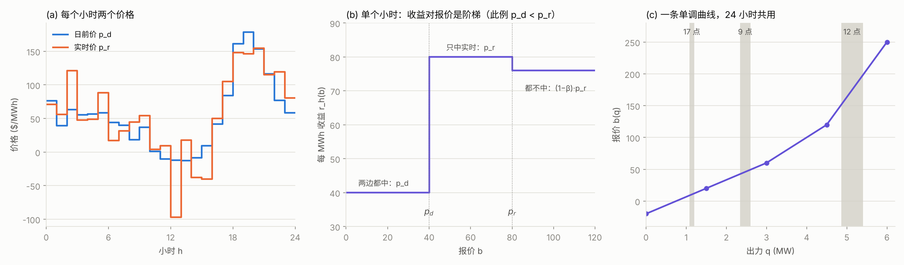
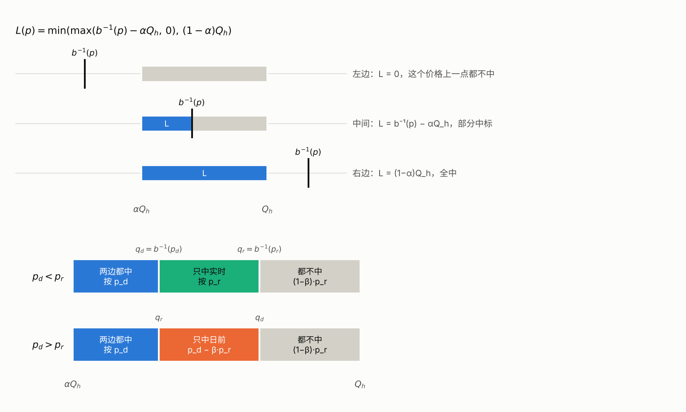

# 推导：一条报价曲线的精确最优解

本文把问题从规则一步步写成可以精确求解的形式。符号和代码 `build.py` 保持一致。

## 0. 记号

| 符号 | 含义 |
|---|---|
| $h = 1, \dots, 24$ | 交付小时 |
| $Q_h$ | 第 $h$ 小时的预测出力 (MW) |
| $\alpha$ | 无条件出清的比例；只有窗口 $[\alpha Q_h, Q_h]$ 受报价影响 |
| $\beta$ | 回收比例：实时没中标却发出的电，按 $\beta p_{r,h}$ 扣回 |
| $p_{d,h}$, $p_{r,h}$ | 同一个交付小时的日前价、实时价 |
| $b(q)$ | 报价曲线：第 $q$ 个 MW 的最低可接受价格，随 $q$ 单调不减，24 小时共用 |
| $b^{-1}(p)$ | 在价格 $p$ 下能中标多少出力，即 $\sup\lbrace q : b(q) \le p \rbrace$ |

中标后按**市场价**结算，报价 $b$ 只决定中不中，不决定拿多少钱。

## 1. 问题长什么样



- (a) 每个小时有两个价格，大小关系逐小时变化。
- (b) 只看一个小时、一小份电，收益对报价 $b$ 是三级阶梯，转折点在 $p_d$ 和 $p_r$。
- (c) 难点在于一天只能交**一条**单调曲线。时间轴通过 $Q_h$ 映射到出力轴：每个小时只读曲线上 $[\alpha Q_h, Q_h]$ 那一段。出力大的小时读右边，出力小的读左边。

## 2. 一小份电的收益 $r_h(b)$

报价为 $b$ 的一小份电，有四种结果：

| 结果 | 条件 | 每 MWh 收益 |
|---|---|---|
| 两边都中 | $b \le p_d$ 且 $b \le p_r$ | $p_d$ |
| 只中日前 | $p_r \lt b \le p_d$ | $p_d - \beta p_r$ |
| 只中实时 | $p_d \lt b \le p_r$ | $p_r$ |
| 都不中 | $b \gt p_d$ 且 $b \gt p_r$ | $(1-\beta)\,p_r$ |

两个规则决定了这张表：

- **日前中不中，决定按哪个价结算。** 日前中标就按 $p_d$；没中，这份电是偏差电量，按 $p_r$。两边都中时只按 $p_d$，不会两边都拿，也不会挑高的。
- **实时中不中，决定扣不扣钱。** 实时没中却仍然发电，就扣 $\beta p_r$，和日前中不中无关。

**用"基准 + 增量"合成一个式子。** 以"都不中"作基准，每次只打开一个示性函数，看收益变了多少：

- 只打开 $\mathbf{1}\lbrace b \le p_r \rbrace$：从 $(1-\beta)p_r$ 变成 $p_r$，增量 $A = \beta p_r$；
- 只打开 $\mathbf{1}\lbrace b \le p_d \rbrace$：从 $(1-\beta)p_r$ 变成 $p_d - \beta p_r$，增量 $B = p_d - p_r$。

$$
r_h(b) = (1-\beta)\,p_{r,h} + \beta\,p_{r,h}\,\mathbf{1}\lbrace b \le p_{r,h} \rbrace + (p_{d,h} - p_{r,h})\,\mathbf{1}\lbrace b \le p_{d,h} \rbrace
$$

**验算"两边都中"**：$(1-\beta)p_r + \beta p_r + (p_d - p_r) = p_d$，和表格一致。

两个系数都可能为负：

- $p_d \lt p_r$ 时 $B \lt 0$：日前中标反而吃亏，应该报在 $p_d$ 和 $p_r$ 之间，留到实时卖；
- $p_r \lt 0$ 时 $A \lt 0$：实时价为负，在实时中标反而吃亏。

## 3. 一个小时的收益：对出力积分

一个小时里，$p_{d,h}$ 和 $p_{r,h}$ 是常数，变化的是窗口内各个位置的报价 $b(q)$。所以积分变量是出力 $q$，不是时间：

$$
R_h = \int_{\alpha Q_h}^{Q_h} r_h\big(b(q)\big)\,dq
$$

代入 $r_h$，常数项积出窗口长度，示性函数积出"满足条件的那段的长度"：

$$
\int_{\alpha Q_h}^{Q_h} \mathbf{1}\lbrace b(q) \le p \rbrace\,dq = L_h(p)
$$

因为 $b$ 单调不减，窗口里满足 $b(q) \le p$ 的 $q$ 一定是从窗口左端开始、到 $b^{-1}(p)$ 为止的一整段。截断到窗口里：

$$
L_h(p) = \min\Big(\max\big(b^{-1}(p) - \alpha Q_h,\ 0\big),\ (1-\alpha)Q_h\Big)
$$



上半部分是截断的三种情况。下半部分把窗口按结算方式切开：$p_d \lt p_r$ 时切成"都中、只中实时、都不中"三段，$p_d \gt p_r$ 时切成"都中、只中日前、都不中"三段。两种情况不需要分开写，下面这个式子自动处理：

$$
R_h = (1-\beta)\,p_{r,h}\,(1-\alpha)Q_h + \beta\,p_{r,h}\,L_h(p_{r,h}) + (p_{d,h} - p_{r,h})\,L_h(p_{d,h})
$$

单位是 MWh × 美元/MWh = 美元。积分在这里只是记账：把这个小时固定的电量拆成按 $p_d$ 结算、按 $p_r$ 结算、被回收的几部分。第一项和报价无关，优化时可以去掉；前 $\alpha$ 部分按优先消纳价结算，也和报价无关，不计入。

## 4. 一天：48 个点

全天收益是 24 个 $R_h$ 相加。去掉常数项后，剩下 48 项，每项只含一个未知量：

$$
\text{Revenue} = \text{const} + \sum_{h=1}^{24} \Big[ \underbrace{\beta\,p_{r,h}\,L_h(p_{r,h})}_{\text{实时点}} + \underbrace{(p_{d,h} - p_{r,h})\,L_h(p_{d,h})}_{\text{日前点}} \Big]
$$

把这 48 个价格统一编号为 $p_1, \dots, p_{48}$，每个点记下它属于哪个小时 $h(k)$、是日前点还是实时点。令

$$
q_k = b^{-1}(p_k), \qquad f_k(q) = c_k \cdot \min\big(\max(q - \alpha Q_{h(k)},\ 0),\ (1-\alpha)Q_{h(k)}\big)
$$

其中实时点的系数 $c_k = \beta p_{r,h}$，日前点的系数 $c_k = p_{d,h} - p_{r,h}$。于是：

**整条曲线只通过 48 个数 $q_k$ 影响收益。** 两条曲线只要在这 48 个价格处的 $b^{-1}$ 相同，收益就相同，中间怎么连都没关系。

**约束是一条链。** 把 48 个点按价格从低到高排序后，$b$ 单调要求

$$
q_1 \le q_2 \le \cdots \le q_{48}
$$

价格完全相同的点必须取同一个 $q$，所以先把它们合并成一个点，$f$ 相加。

注意：同一个小时的日前点和实时点在排序后可能相隔很远。正因为 $R_h$ 拆成了两个各只含一个 $q$ 的 $f_k$，链式结构才成立。

于是问题变成：

$$
\max_{q_1 \le \cdots \le q_K} \sum_{k=1}^{K} f_k(q_k)
$$

目标可分，约束是一条链：这正是动态规划能精确求解的结构。

## 5. 动态规划

### 5.1 候选值只需取窗口端点

每个 $f_k$ 是分段线性的，拐点只在自己窗口的两个端点 $\alpha Q_h$ 和 $Q_h$。设某个最优解里有一组相邻的点取同一个值 $v$，在不碰到相邻组的范围内移动 $v$，这组的收益之和是 $v$ 的分段线性函数，拐点是这组各点的窗口端点。线性函数的最大值在区间端点取到，所以总能把 $v$ 移到某个窗口端点，或者移到相邻组的值上（两组合并），而收益不降。反复这样做，所有 $q_k$ 都落在

$$
\mathcal{C} = \lbrace \alpha Q_h,\ Q_h : Q_h \gt 0 \rbrace
$$

里，最多 48 个值。出力为 0 的小时窗口长度为 0，直接去掉。

### 5.2 不限制曲线形状

设 $V_k(v)$ 为前 $k$ 个点、第 $k$ 个点取 $v$ 时的最大收益：

$$
V_k(v) = f_k(v) + \max_{u \le v} V_{k-1}(u)
$$

只往回看一步就够了，原因有两个：

1. **目标可分**：没有任何一项同时含两个 $q$，前面各点的收益都打包在 $V_{k-1}$ 里；
2. **约束是链**：$q_1 \le q_3$ 由 $q_1 \le q_2$ 和 $q_2 \le q_3$ 推出，点 1 对点 3 的影响一定经过点 2。

所以未来只需要知道上一个点取了什么值，不需要知道前面是怎么走到这里的。这个结果是所有单调报价曲线能达到的**上界**。

### 5.3 限制跳变次数

市场要求曲线只能有少数几段（比如 5 点 4 段），曲线就不能把每个点都放在它想要的位置。在动态规划里加一个计数：$s$ = 到第 $k$ 个点为止，$q$ 一共变化过几次。

$$
V_k(v, s) = f_k(v) + \max\Big( V_{k-1}(v, s),\ \max_{u \lt v} V_{k-1}(u, s-1) \Big)
$$

- **不变**：上一个点取同一个 $v$，计数不变；
- **跳变**：上一个点取更小的 $u$，计数加 1。

最优值是 $\max_{v,\ s \le S} V_K(v, s)$。$f_k(v)$ 只取决于终点 $v$，和从哪里来无关，所以提到 $\max$ 外面。

**$S$ 和段数的关系。** 限制 $S$ 次跳变，等于在**阶梯形**曲线里找最优：$S+1$ 级台阶，每级是一段竖直线，级与级之间用一段连接线。这样的曲线一般需要 $2S+3$ 段；最低一级若取最小候选值，可以贴着 $q=0$，省一段；最高一级若取最大候选值，可以贴着满容量，再省一段。所以 5 点 4 段的阶梯最多对应 $S=1$，而且至少要有一级贴边。允许斜线的 4 段曲线不在这个动态规划的范围内，留作下一步。

另外，"单一报价"（一条水平线）是 $S=1$ 的特例：跳变前的点全取最小值、跳变后的全取最大值，只能选在哪里跳。所以三者总满足

$$
\text{单一报价} \le \text{最多跳 1 次} \le \text{不限跳变}
$$

### 5.4 例子

三个点（已按价格排序），候选值 $v \in \lbrace 1, 2, 3 \rbrace$，最多跳 1 次（$S = 1$）：

| $v$ | $f_1$ | $f_2$ | $f_3$ |
|---|---|---|---|
| 1 | **3** | 0 | 0 |
| 2 | 0 | **2** | 0 |
| 3 | 0 | 0 | **4** |

每个点想要的值都不同。不加限制时最优解是 $(1, 2, 3)$，收益 9，但要跳两次。

**点 1**：还不可能跳过。

| $v$ | $s=0$ | $s=1$ |
|---|---|---|
| 1 | 3 | $-\infty$ |
| 2 | 0 | $-\infty$ |
| 3 | 0 | $-\infty$ |

**点 2**：例如 $V_2(2,1) = f_2(2) + V_1(1,0) = 2 + 3 = 5$。

| $v$ | $s=0$ | $s=1$ |
|---|---|---|
| 1 | 3 | $-\infty$ |
| 2 | 2 | 5 |
| 3 | 0 | 3 |

**点 3**：

$$
V_3(2,1) = f_3(2) + \max\big(V_2(2,1),\ V_2(1,0)\big) = 0 + \max(5, 3) = 5
$$

$$
V_3(3,1) = f_3(3) + \max\big(V_2(3,1),\ V_2(1,0),\ V_2(2,0)\big) = 4 + \max(3, 3, 2) = 7
$$

| $v$ | $s=0$ | $s=1$ |
|---|---|---|
| 1 | 3 | $-\infty$ |
| 2 | 2 | 5 |
| 3 | 4 | **7** |

最大值是 7，比不限跳变少 2。$V_3(3,1)$ 的两个来源打平，所以有两个最优解：


两条路径的区别只在于那一次跳变放在点 2 之前还是之后，点 2 都落不到它想要的 2。三个偏好里点 2 的价值最小，只能跳一次时被牺牲的就是它。

用同一张表还可以检验：$S = 0$ 时三个点只能取同一个值，最优是全取 3，收益 4；$S = 2$ 时回到不限跳变的 9。

### 5.5 倒推和实现

表格只给出最优值，要得到每个点的 $q_k$，需要倒推。做法是在正向填表时，每一格记下它是从上一个点的哪一格来的（一个"箭头"），倒推时从最大格出发沿箭头往回走，读出每一格的 $v$。

正向时只能记箭头，不能直接记"这个点选了哪一格"：比如点 2 那张表里最大的是 $V_2(2,1)=5$，但最终两个最优解里 $q_2$ 都不是 2。哪一格在最优路径上，要等最后一个点算完才知道。

- `V`：形状 `(K, M, S+1)`，浮点数，不可能的状态用 `-inf`；
- `arrow`：形状 `(K, M, S+1, 2)`，整数，存来源的 `(u, s)`，`-1` 表示起点；
- 平手时优先"不变"（`stay >= jump`），倒推得到的就是正向选中的那条路径。

```python
for k in range(1, K):
    for v in range(M):
        for s in range(S + 1):
            stay = V[k-1, v, s]
            if v > 0 and s > 0:
                u = int(np.argmax(V[k-1, :v, s-1]))
                jump = V[k-1, u, s-1]
            else:
                u, jump = -1, -np.inf
            if stay >= jump:
                V[k, v, s] = f[k, v] + stay
                arrow[k, v, s] = [v, s]
            else:
                V[k, v, s] = f[k, v] + jump
                arrow[k, v, s] = [u, s - 1]

v, s = np.unravel_index(np.argmax(V[K-1]), V[K-1].shape)
path = [v]
for k in range(K - 1, 0, -1):
    v, s = arrow[k, v, s]
    path.append(v)
path.reverse()
```

完整实现见 `build.py` 里的 `build_points`（构造 $f$）和 `solve`（动态规划）。
